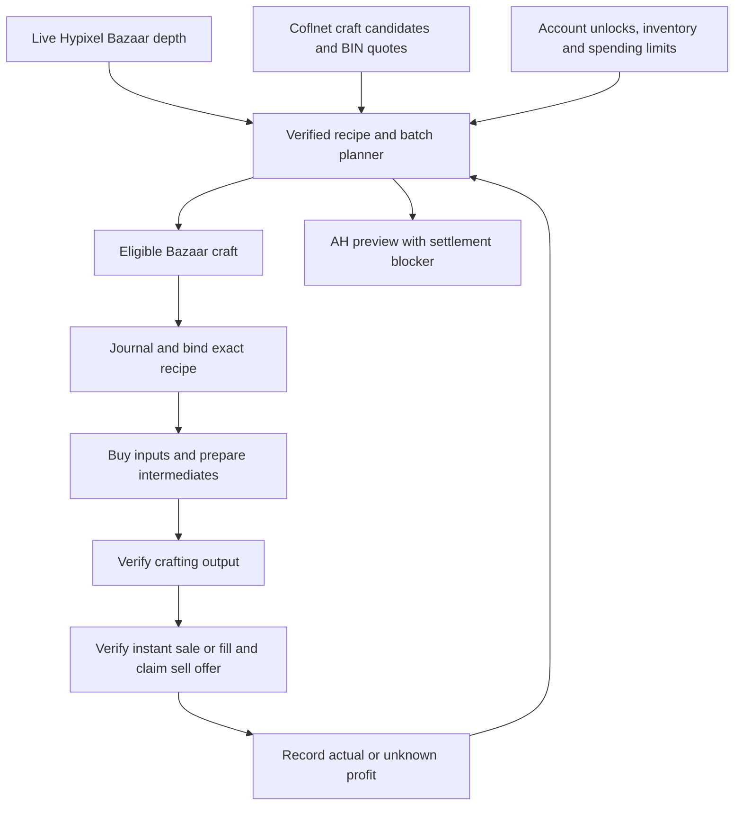

# Craft flip discovery and execution — 0.2.67

## Shipped behavior

Select **CRAFT** in G → Macros → Mode and start with the existing trading toggle.
This mode selects eligible Bazaar crafts, buys their missing base materials,
prepares reviewed basic intermediates, crafts the exact ranked recipe, and
uses the selected instant sale or sell offer. Inputs use the selected instant
purchases or buy orders. It then recomputes the next route from live data.
Books/general order engines do not start in this mode. Existing lifecycle,
account/profile binding, stop, recovery and menu ownership rules still apply.

The craft plan is available while stopped too: local dashboard → **Craft production
plan**, or `.a* goofyaddon production flips`. GUI settings control sale market,
maximum batch capital (zero uses spendable capital), minimum net profit and batch
limit (1–64). AH-only selection currently produces previews and no automatic buys.



## Sources and contracts

- Bazaar inputs/output prices come from the normal public Hypixel Bazaar API,
  refreshed through the existing collector/Bazaar API adapter. Quotes over 60
  seconds old are unusable.
- Coflnet supplies AH craft candidates through `/api/crafts/profit`; public
  SkyCrafts controller path `/crafts/profit` and `ProfitableCraft` fields are
  documented in [Coflnet/SkyCrafts](https://github.com/Coflnet/SkyCrafts/tree/1d25352d31cfa94f04a797bd7c120e4d0bc3b565).
  Coflnet's [official crafting command](https://github.com/Coflnet/SkyModCommands/blob/8f8e8e95db043b87ac0e0fb53a4085511c4e3b87/Commands/State/CraftsCommand.cs)
  calls `GetProfitableAsync`. Rows must identify a crafting route, contain positive
  cost/price/volume/median values, and be updated within five minutes.
- The local endpoint `/v1/crafts/market` returns `goofy-craft-market/1`, sanitized
  candidates and separately refreshed `goofy-ah-price/1` lowest BIN quotes. No
  auction UUID is returned or used for navigation. Bazaar output IDs are excluded
  from AH discovery when the companion has a fresh Bazaar snapshot.
- Discovery refreshes at most once a minute; bounded quote rotation runs at most
  every 20 seconds. Four leading candidates plus four rotating candidates are
  considered per update. Quotes expire after 60 seconds. Discovery failures do
  not prevent Bazaar ranking and never supply invented prices.
- Use the existing private `COFLNET_TOKEN` environment variable or
  `coflnet-token.txt` in the companion data directory if the API needs access.
  Credentials remain private and are sent only to Coflnet.

External candidates must match the mod's bundled, validated NEU-derived crafting
grids. Unknown recipes are never converted into guessed clicks. Forge, Kat, NPC
shop and non-crafting rows cannot enter this automatic craft loop.

## Feasibility and ranking

Each candidate evaluates whole batches, not arbitrary scaled top prices:

1. Expand reviewed basic intermediates (rods → powder, logs → planks → sticks,
   etc.) using the same preparation planner as execution. An input without fresh
   Bazaar depth is unsupported for automatic procurement.
2. Walk the full ask-side input depth; include the existing observed 4% instant-buy
   surcharge and a 3% total procurement allowance.
3. Walk bid-side output depth for the entire Bazaar batch; subtract configured
   tax and a 3% sale-price movement allowance. AH previews use a fresh validated
   lowest BIN, the conservative listing fee ceiling, a 10% GUI-price allowance
   and a 3.5% claim-tax allowance. These are estimates, not paid receipts.
4. Fit the batch inside spendable funds, configured batch capital, empty inventory
   space, grid/output/intermediate capacity and the 1–16 batch executor limit.
5. Require observed collection/skill/slayer unlocks. Skip conflicting positions,
   held outputs and unreadable Personal Compactor configurations. Known compactor
   recipes are cleared by the production preflight before inputs are bought.
6. Limit a Bazaar batch to 5% of daily volume estimated from the smaller weekly
   buy/sell counter. Rank using conservative net profit, estimated GUI work and
   liquidity. Coflnet's reported volume affects AH confidence without assuming
   its unspecified time window is daily volume.

The ranking score is an ordering aid, **not realized coins/hour**. Craft timings
are estimates; order-flip gameplay corrections are not applied to craft routes.
A shared per-craft timing/profit learning contract remains future work.

Before queueing, the mod recomputes eligibility from current inventory and budget.
The production run binds the selected recipe key through final crafting. Before
further purchases, fresh output depth must still clear the minimum-profit target.
The run's aggregate spending envelope shrinks by receipt-confirmed purchases.
Completed output is sold at the then-current verified quote; sale is not blocked
by the original profit target after crafting.

## Receipts and profit

A completed output and an instant sale produce idempotent `craft` profit-ledger
events. Cost is receipt-confirmed input spending. Using previously held inputs
makes cost basis unknown; the ledger counts that settlement as incomplete rather
than treating old materials as free. All bought material costs are conservatively
charged to this run, including any preparation surplus; surplus cost lots are
not yet allocated across later craft runs.

A production instant sale requires the expected items to disappear and a purse
increase within the quoted range. An unrelated large purse change is uncertain
and cannot create confirmed profit. Publication of an AH listing never counts as
a completed sale. Saved interrupted transactions continue to require review.

## Remaining AH pipeline work

AH crafts appear in the plan with an explicit settlement blocker. The existing
`.a* goofyaddon production test ITEM_ID` can individually buy supported Bazaar
components, craft, validate normal /ah GUI prices against Coflnet, and publish
one verified BIN listing. This does not implement AH-component procurement or
sale/expiry/claim reconciliation. Multi-output AH batches remain unsupported.

Before enabling automatic AH loops, implement tracked listing capacity/capital,
exact seller-listing reconciliation, sold/expired state handling, claim receipts,
actual listing/claim fees and recovery after reconnect. Arbitrary attributes,
reforges and pet variants also need their own pricing/identity contracts.

## Validation limits

Automated Java/Node tests and a Chromium dashboard check cover planning, source
validation, fee/depth/capacity gates, menu composition, recipe pinning, receipts,
redaction and stale-data behavior. Live Minecraft execution and the deployed
Coflnet gateway still need real-session validation; direct gateway access from
this development environment returned HTTP 403. The controller/model contract
was verified from Coflnet's public source instead.

## Stacked crafting (0.2.28)

The executor now loads ingredients for several recipe uses before collecting the
output. Each grid cell is bounded by its ingredient's observed stack limit,
available ingredients, remaining requested batches and conservative output space.
Known basic stackable outputs reserve space at 64 units per slot; unknown outputs
reserve one slot per unit. Large recipes are split into chunks that fit the grid.
Intermediate preparation child jobs now accept up to 64 recipe uses instead of 16.
The existing final-production investment and batch limits remain unchanged.

For 64 blaze rods, the grid is filled once and the 128 powder is checked against
64 consumed rods. If the server's shift click produces just one recipe use, the
remaining ingredients stay loaded and the executor collects subsequent outputs.
No refill occurs between those partial collections. Progress advances only after
exact ingredient/output conservation and an empty grid/cursor are verified; the
journal saves the verified chunk's actual completed recipe uses in one write.

Normal acknowledged actions settle for 50 ms (one game tick) rather than 100 ms.
Slowdown messages increase this delay and impose the existing one-second cooldown.
Unchanged/rejected inputs retain bounded retries; unexplained inventory changes
pause execution with owned items retained. This does not batch unacknowledged
clicks or assume shift-click output succeeded. Live server behavior still needs
validation with the downloadable mod.

`.a* goofyaddon craft OUTPUT_ID 64` can queue up to 64 uses from held ingredients;
start it with the usual trading toggle. Smaller requested quantities stay exact.

## Account lookup and cold startup (0.2.29)

Craft prerequisites no longer depend on the localhost calculator being available.
The mod calls the same fixed HTTPS `/v1/profiles?username=...` service as the public
website, using the normal Java HTTP proxy policy rather than the loopback-only
client. It needs no player API key or contributor key. Account/profile identity,
live-skill agreement, unknown collection handling and the five-minute freshness
limit remain enforced before spending. An unavailable service, a missing unlock,
wrong profile or expired response still blocks purchases. Service failures retain
bounded backoff and clear error codes; diagnostics identify `PUBLIC_WEBSITE` as
the source. No account profile is uploaded to the shared gameplay dataset.

This separates progression verification from the calculator's market/feed/upload
process. Automatic market selection, the local dashboard and shared learning still
need that process. The calculator now registers its bundled website allowlist but
reads each static file only on first request, rather than reading more than 5,000
files before opening its port. The supervisor allows up to 45 seconds for cold
startup, off the game thread, while still noticing an immediate Node exit. It
continues to preserve pairing keys, saved history and existing configuration.

The screenshot's `Local calculator connection failed` proves the old prerequisite
request could not reach the local server; it does not identify the Node process's
original startup error. If the dashboard/feed still waits after this update,
export F7 diagnostics. Its supervisor state, last exit code and redacted
`companion-error.log` tail are needed to identify that separate runtime failure.
No public website redeployment is necessary for this mod-side account fix.
The shared-learning Sync status now includes the supervisor's reason when the
calculator is unavailable (auto-start off, port conflict, preparing or failed),
rather than displaying an indefinite generic wait with no explanation.

## Reusing the crafting GUI (0.2.30)

Ingredient preparation and final crafting in a craft production run now reuse the
same clean Craft Item menu. Child jobs leave it open only after the executor
verifies the outputs and an empty grid/cursor. The parent retains menu ownership
between child jobs, then hands it directly to the next crafter; ordinary traders
cannot take that GUI during the handoff. Metadata-only handoffs use 50 ms pacing
instead of the normal trading action delay. Recipe and journal checks still run
for every child job, including a reused menu.

A standalone craft closes its menu on completion as before. A production run
closes its retained menu when it finishes without a sale, or when it needs to
switch to Auction House listing. Bazaar navigation replaces it with the required
product menu. Forge/Kat preparation keeps the former standalone-close behavior.
No occupied cursor or unfinished grid is adopted for the next recipe.

## Clearing compactor filters before production (0.2.31)

Every craft and Forge production run clears all recipes from every detected
Personal Compactor before procurement. Standalone crafting uses the same gate.
This includes unrelated filters and disabled compactors; the ON/OFF setting is
preserved. Existing filters are intentionally not restored, per the user's
request to start with an empty configuration. These are filter entries, not
inventory stacks: clearing them does not sell, drop, or delete materials.

The two supplied 7000 menu captures verify all twelve numbered controls, their
product IDs, removal lore, empty-filter lore and the activation toggle. Sanitized
fixtures retain only menu fields, without account or session details. Each
removal intent is saved in the production journal before its click. The executor
waits for the exact expected filter map, checks that inventory counts did not
change, and finally closes the menu and verifies empty saved item metadata. A
missing acknowledgement, replaced container, unexpected recipe change or changed
inventory stops the run for review; removal clicks are not blindly replayed.

Automatic opening uses an owned hotbar compactor. Put each compactor in the
hotbar for automatic clearing, or manually open an inventory compactor's menu.
Unreachable or unreadable detected devices block production rather than being
skipped. Only devices observed in inventory or the current Accessory Bag page
can be checked; this does not inspect unseen bag pages. Book/general trading
and Kat pet upgrades do not enter this crafting preflight. Automatic bulk
compaction remains disabled; this release adds the required initial cleanup.

## Craft mode and one-item AH tests (0.2.32)

The saved `CRAFT` mode is now labelled **Craft flips** in the settings mode
selector, with a **Use craft mode** shortcut on its card. Wait for “Settings saved” and
use Start for automatic Bazaar craft selection. AH recommendations remain
individual tests until sale/expiry/claim reconciliation is implemented.

With trading stopped, use:

```text
.a* goofyaddon production testah ASPECT_OF_THE_END
```

Alternatively enter a product ID in **AH test item**, then click **Run one test**
on the Craft flips settings card. Resolve or discard invalid pending settings first. The
test buys missing inputs within spending limits, clears detected compactor
filters, checks account prerequisites, crafts one item and publishes one BIN.
It runs independently of the trading mode and rest schedule. Stop/toggle ends
it. It never treats publication as a confirmed sale or profit.

Aspect of the End requires Ender Pearl VIII and uses 32 Enchanted Eyes of Ender
and one Enchanted Diamond: 16 eyes in each of the two sword blade cells, with the
diamond as its handle. An AH test accepts only a verified recipe yielding one
item per batch. Move any matching output already held before testing another
craft; existing seller listings do not themselves prevent a new test.

`testah` always chooses the Auction House. With no price supplied, Coflnet provides
a price-only reference, refreshed again after crafting before the listing is
priced one coin below the fresh lowest BIN. Selling navigates `/ah` directly to
Create Auction or Manage Auctions, without opening the Auctions Browser. The
explicit-price form is `production testah <productId> <price>`; it still passes
the GUI and Coflnet validity checks. The original `production test` keeps
its automatic Bazaar/AH choice. Unknown recipes are rejected before price lookup.

Four sanitized live AH captures now cover **Co-op Auction House**, the empty
**Create BIN Auction** form, the compact **Confirm BIN Auction** button and the
resulting **BIN Auction View**. Navigation accepts solo and co-op home titles.
The compact confirmation contains a Selling name and listing fee, without an
item stack or sale price: it is accepted only after this executor verified the
exact identity, price and duration in the creation form, clicked Create once,
observed a different container, and verified unchanged player inventory. It must
show the matching Selling name and exact bounded fee. A generic confirmation,
wrong name, conflicting price or changed inventory cannot publish.

Publication can finish at the observed own **BIN Auction View**, as well as
Manage Auctions. Both still require the exact item identity and price, no item
left in inventory and the exact fee debit. The view must explicitly say it is
the player's own auction. No buy/cancel controls are clicked to prove receipt.

## Direct auction selling and sign-editor transitions (0.2.33)

The latest diagnostic shows AOTE crafting completed, then selling entered the
Auctions Browser for a market-price check and paused as its search sign opened.
Sales now fetch only a fresh Coflnet price, validate item ID, age, outlier and
price bounds, and start BinListingExecutor directly. At Co-op Auction House this
clicks the observed Create Auction control, rather than Auctions Browser. The
existing creation-form identity/price, fee ceiling, confirmation, own-listing
and receipt checks remain required. No API auction IDs are used. Pausing or
finishing clears the queued price-check/item state.

BIN purchases still use normal browser navigation. Expected search and price
signs are write-only steps, so their handler runs before checking the underlying
container cursor. Hypixel's sign transition can temporarily expose a carried
control; after return, the empty-cursor and exact-item checks apply again before
any item movement, selection or publication. Each expected sign is written once.
An unexpected sign or a cursor still occupied after return blocks the operation.
The regression uses the supplied browser's actual Search (48), Sort (50) and
BIN Filter (52) controls; the fixture excludes auction items and seller details.


## Navigation lag recovery (0.2.34)

Auction browsing and BIN creation wait up to 15 seconds for missing controls,
search results, confirmation controls and transient cursor state. Deadlines are
tracked by missing evidence, so polling cannot restart them indefinitely. No
placeholder is clicked. Ambiguous creation buttons, wrong items, changed prices
and excessive fees still block; a permanently missing control ends with a
specific failure and no guessed transaction.

The production Bazaar buyer now uses NavigationRetry for Buy Instantly (opening
the amount screen) and Custom Amount (opening the sign). An unchanged, verified
control must remain stable for 750 ms; retries start after 3 seconds and stop
after three retries or 15 seconds. Changed screens and sign editors acknowledge
navigation. These retries precede purchase intent and never replay a preset buy,
amount submission or purchase confirmation. Bazaar search already reopens after
an unacknowledged product selection; the crafting executor already retries
verified grid inputs with conservation checks and adaptive pacing.

Item transfer, auction creation and final publication remain single submissions.
Uncertain transactions require reconciliation rather than blind replay. This
release improves recoverable menu lag; it does not automatically resume a run
whose inventory or coin evidence cannot establish what happened.

## Full craft catalog coverage (0.2.35)

The catalog increases from 2,259 to 2,529 craft rows, adding 270 rows. The importer
uses NEU revision `c4f7d4757641f3a11c74d3d77cec76c100abaf98` and accounts for all
2,561 distinct source grids, including top-level grids on items also offering
NPC trades. Of those, 2,528 are validated and imported; one prior duplicate key
is preserved for saved jobs. All prior crafting keys remain available.

Legacy item variants now use Hypixel's colon IDs, and recognized enchantment
books use `ENCHANTMENT_NAME_LEVEL` IDs. Counts, nine-cell totals, yields and
collection/skill/slayer/reputation gates remain validated. New recipes include
bait sacks, Hotspot accessories, colored/wood variants and enchanted books.

The 33 remaining source grids are recorded with exact source grids and reasons:
32 pet/shard variants require exact identity and yield handling, and one
conversion consumes its own output ID. They are not enabled for automatic
crafting. The website shows this coverage and searchable exclusion list. The
reproducible importer and maintenance workflow are in `tools/recipes/README.md`.
Prices, component availability, unlocks and spending limits still filter routes;
this release does not add AH-component purchases or automatic AH settlement.

Use `.a* goofyaddon production recipes` for catalog totals, or
`.a* goofyaddon production recipes SMALL_BAIT_SACK` for a recipe's inputs/gates.
Quote IDs containing punctuation, for example
`.a* goofyaddon production recipes "WOOD:1"` or
`.a* goofyaddon production recipes "ZOMBIE;0"` (an excluded pet recipe).
The public website ZIP must be redeployed to update an existing Worker; installing
the new JAR updates its bundled local calculator automatically.

## HotM and Slayer prerequisites (0.2.36)

Profile imports supply Heart of the Mountain and Zombie, Spider, Wolf, Enderman,
Blaze and Vampire Slayer levels. Craft and workstation routes check their catalog
requirements before buying materials and again before submission. Missing, stale
or invalid account evidence keeps the route blocked with its unmet requirement.
When Hypixel publishes Slayer `claimed_levels`, usable tiers are limited to the
claimed rewards; profiles without that field retain the XP-based level.

Forge access requires HotM II. The configured slot must also be available at the
observed tier (up to seven slots), and each recipe can require a higher tier.
Actual confirmation controls are checked for additional HotM/Slayer requirements.
Already submitted jobs can still reconcile receipts and claim outputs if account
evidence expires. Catalog codes such as `WOLF_3` and `EMAN_6` now normalize to
readable Slayer requirements rather than blocking as unknown text.

Use `.a* goofyaddon production requirements` to inspect profile status, HotM and
all six Slayer levels. Install the new JAR for local execution checks. Redeploy
the 0.2.36 public website ZIP for the updated Worker profile import and website
Slayer summary; existing secrets and deployment configuration are retained.

## Essence, Dungeon and mutation gates (0.2.37)

The selected-profile import now reports Catacombs level from dungeon XP and
normal/Master Catacombs floor completions as separate facts. A high level never
implies a cleared floor. Missing or invalid progression stays unobserved.

All eight Bazaar essence types require Catacombs XX. The mod excludes them
from general selection and rankings below that level or without fresh account
evidence. The local adapter checks the same gate, and craft procurement checks
its output and ingredient product gates before navigation or spending.

The shared product catalog covers all 40 Garden mutations in the current NEU
snapshot. Mutation-dependent recipes need verified inspection/analysis evidence;
mutation sacks also retain their Crop Analyzer Milestone gates. The 0.2.37 parser did not read either fact, so these routes remained blocked as
unverified. The current-field import in 0.2.38 below corrects this. This release preserves the prior general-trading mutation exclusion;
it does not automate crop analysis or infer it from collection tiers. Explicit
unmet analysis/inspection text on purchase controls blocks the transaction.

Recipe text and action controls can require Catacombs levels and normal/Master
floor completions. Equipment-use lore is not added as a crafting prerequisite:
being unable to equip a dungeon item does not prove that crafting it is forbidden.
Server crafting controls remain authoritative for additional requirements.

`.a* goofyaddon production requirements` now includes Catacombs and explains
mutation evidence. Install the 0.2.37 JAR and redeploy its public website ZIP for
the profile-import and website changes. Existing deployment secrets are retained.

## Current profile progression fields (0.2.38)

Hypixel's migrated profiles use `skill_tree.experience.mining` for HotM,
`skill_tree.nodes.mining.quick_forge` for Quick Forge and
`slayer.slayer_bosses` for Slayers. The importer now reads these first, with
legacy `mining_core` and top-level `slayer_bosses` fallbacks. A published mining
node map without Quick Forge means level zero; missing or invalid maps remain
unknown. Current Slayer maps supersede legacy maps, including empty maps.

Garden analyzed crops come from `garden_player_data.analyzed_greenhouse_crops`,
normalized to product IDs; discovery alone never proves analysis. Crop Analyzer
milestones come from claimed `objectives.tutorial` entries matching
`dna_analysis_rewardskyblock_xp_N` (1–6), rather than counts of discovered crops.
Fresh account/profile binding and bounds still apply in the mod. These facts
unblock eligible crafting requirements; the existing general-trading mutation
exclusion is retained. Missing fields continue to block their dependent routes.

Mappings were checked against SkyCrypt-Backend `5252bf6` (mining, Slayer and
Garden stats) and SkyCrypt-Types `80de98c` (profile JSON tags). No SkyCrypt service
is needed for production: the Worker continues to fetch Hypixel directly.
The `/v1/profiles?username=...` response now includes
`parserVersion: "2026-10-10-skill-tree"` so deployments can be identified.
The 0.2.38 public website ZIP must be redeployed to update this parser.

## Remaining account unlocks (collector patch 0.2.39)

Published Slayer maps now enumerate all six bosses. An omitted boss/counter in
a published map is represented as zero progression, including Blaze/Vampire;
missing whole sections, explicit nulls and invalid XP remain unknown. Published
Garden records without an analyzed-crop list represent no analyzed mutations.
Malformed/absent Garden records remain unknown. This never unlocks a positive
requirement or treats discovery as analysis.

Vanilla XP is omitted from the account-summary warning list at the user's
request. No XP feature, live XP hook or extra settings were added. The existing
API cannot establish that value, and no skill XP is substituted for it.
This patch changes the hosted collector only; the 0.2.38 mod remains compatible.
The profile endpoint reports `parserVersion: "2026-10-10-unlock-completeness"`.

## Heart of the Forest audit

The current NEU snapshot (`c4f7d4757641f3a11c74d3d77cec76c100abaf98`) declares
no crafting requirement containing HotF or Heart of the Forest. Relevant Fig
recipes use collection tiers instead: Enchanted Fig Log requires Fig Log II and
Fig Axe requires Fig Log IV. Existing collection import/gates handle these.
No HotF restriction is added without a declared crafting prerequisite. This is
a catalog audit, not a claim about every NPC shop or equipment-use unlock.

For future HotF gates, current progression is `skill_tree.experience.foraging`
(SkyCrypt-Backend `5252bf6`, stats/foraging.go); the NEU `HOTF` XP-cost table
contains eight tiers. Live official wiki retrieval returned HTTP 403 during
this audit, so additional wiki-only prerequisites could not be verified.

## Complete calculator coverage (0.2.40)

The craft planner now evaluates all 2,481 distinct crafting outputs in the 2,529-row
catalog instead of silently discarding outputs absent from Coflnet discovery.
Alternative recipes compete by feasibility and conservative score. Search, venue
filters and "Show 100 more crafts" expose the entire result set; absent prices
produce a blocked row with unknown profit, never a fabricated zero-cost route.

Costs use current Bazaar ask depth or an item-specific, fresh Coflnet lowest BIN
for AH components. Missing tradable intermediates expand recursively into catalog
recipes; basic preparation still favors rods/logs over powder/sticks. Whole-batch
yields, excess ingredients, recipe coin costs, intermediate unlocks, product gates,
sell depth, taxes, price allowances and per-output AH listing fees are included.
Cyclic/unpriceable dependencies terminate as unavailable purchases. Existing
priced intermediate items remain direct purchases; this is not an exhaustive
optimizer of every buy-versus-craft combination.

Both the local companion and public Worker quote catalog AH outputs/components,
including items absent from craft discovery. Quote requests stay bounded and
rotate across the catalog. Searching prioritizes that catalog output and its direct
components; the public cache accepts only known catalog output IDs as focus keys.
Discovery failures do not prevent catalog quotes or Bazaar calculations.

Important limits: all catalog routes can be evaluated, but not all are tradable.
AH rows without fresh prices remain unpriced. Missing provider demand blocks an
AH recommendation while retaining its available profit estimate. Repeated AH
components are priced at current lowest BIN per unit, not verified listing depth;
actual quantities/variants and final prices must be checked in game. Estimates do
not add AH procurement or sale settlement to automatic craft selection. Quotes
expire after 60 seconds; discovery demand expires after five minutes. No synthetic
coins/hour is inferred from an AH volume with an unknown time window.

## Persistent AH collection (0.2.45)

The existing 15-minute Cloudflare trigger now runs public AH collection independently
of gameplay publication. It refreshes craft discovery and rotates 12 additional AH
items plus four leading candidates for BIN prices and provider sales summaries.
The cursor survives Worker restarts in D1; collection runs without website visitors
or contributor credentials. Public catalog searches also save verified observations.

D1 stores 30 days of daily price aggregates by item and source (BIN, provider sales
summary, discovery median). Each item/source contributes at most one sample per
15-minute bucket, preventing refresh traffic from inflating evidence. Rolling
provider volume is kept as a latest observation, never summed as new sales. Old
calendar days are pruned through a day index. No auction UUIDs, player profiles,
chat, keys or trade receipts enter AH history.

The public history endpoint `/v1/crafts/history` returns compact per-item aggregates;
`/v1/crafts/status` reports collection, retained coverage and GitHub publication.
Aggregates refresh about hourly to bound D1 reads. Changed snapshots publish to
`gameplay-data/ah-market-history.json` using the existing private GitHub token.
Market collection and gameplay publication continue independently when one fails.
The live market request still has bounded provider calls and short quote expiry.

The calculator uses historical references up to seven days old to research otherwise
unpriced AH outputs/components. Historical estimates are labelled and remain blocked
until all required prices are fresh. Live quotes take priority. Retained provider
activity can supply liquidity context, but its reporting window is not converted to
coins/hour, guaranteed sale time or receipt-confirmed profit. Account unlocks,
budget, taxes and confirmation checks continue to apply. Older retained data stays
in storage even after it is too stale for a research price reference.

Deployment creates the additive tables lazily; existing D1 data and secrets are
preserved. Deploy the full public package, including the two new runtime modules
and website assets. The corrected local mod includes the same history-aware UI and
proxies the public history endpoints. No separate account-specific data collector
or new contributor key is required for public market observations.

### 0.2.46 — current calculator reference documentation

Replaced the obsolete upstream static contribution/API documentation with a
maintained overlay for Timing & limits, Data files, Contribute, Data status and
Sources. Descriptions now match scheduled AH history, independent gameplay
publishing, real Worker endpoints, key privacy, provenance and the distinction
between live quotes and bundled chart history. Timing is explicitly a model;
historical AH references remain research only pending fresh verification.

### 0.2.47 — find AH-component crafts from either search

Hephaestus Relic and the other Hephaestus recipes were already in the production
catalog. The craft page previously exposed independent searches for the complete
live catalog and the legacy order-based table, whose AH-output toggle defaulted
to off. Both searches now share the same query, and craft research includes AH
outputs by default (including after Reset). Searching Hephaestus Relic requests
fresh output/ingredient quotes and keeps its catalog row visible when budget,
requirements or prices prevent a feasible trade. It requires three Minos Relics
and one Hephaestus Anvil; this change does not invent prices for them.

The build reapplies Flips.tsx overlays from the pinned upstream source so repeated
builds remain reproducible as UI overlays change. Browser coverage checks the
legacy search reaching the Hephaestus Relic row and its Minos Relic pipeline on
both desktop and mobile.

### 0.2.50 — automatic Bazaar craft execution foundation

The existing CRAFT scheduler can select a verified Bazaar route, purchase missing
base materials, craft basic intermediates, process the pinned final recipe, sell
instantly, then select again. This pass hardens that executable loop before AH
procurement and sale reconciliation are enabled:

- Selection applies output and ingredient Bazaar gates (including essence and
  mutations) as well as the recipe's collection/skill requirements.
- Every remaining input must have fresh, sufficient depth and the complete
  fee-inclusive basket must fit spendable funds before the next ingredient is
  bought. A cheap first ingredient cannot strand the run with unpriced or
  unaffordable later ingredients.
- Pre-submission navigation rechecks the basket, selected run budget and minimum
  profit using verified spending plus current remaining costs. Held materials
  with unknown basis retain the original conservative cost allowance.
- After a purchase has been submitted, receipt/inventory verification takes
  priority over changed market signals. The transaction is never replayed.
- A blocked run can be cancelled for reselection only while its journal remains
  PLANNED and it has no spend, active buyer, craft or intermediate intent. A
  compactor/purchase/craft intent prevents automatic cancellation. Started jobs
  keep their journal and require completion or review.
- The HUD/dashboard craft plan reports selection status and eligible route count.

To test: install the new JAR, open trading settings, choose **Craft flips**, set
**Sale market → BAZAAR**, configure batch capital/minimum profit/max batches,
Wait for “Settings saved”, then use the trading toggle. `0` batch capital uses spendable funds under
existing limits. `.a* goofyaddon production requirements` shows imported account
unlock status; `.a* goofyaddon production flips` shows current route candidates.
No manual item list is required. Stop the toggle if an in-game result needs
inspection; uncertain purchases/crafts are journaled for REVIEW, not replayed.

Automatic AH crafts remain blocked pending AH component purchase and
sale/expiry/claim reconciliation. The existing individual AH test command is
still available for validated listings. This release does not claim shared
craft-trade calibration: the community evidence protocol currently accepts
book and general trades. Craft actual profits are tracked locally only when
cost and sale receipts can be verified.

### 0.2.51 — scheduled-rest render failure when pressing the trading toggle

The provided 0.2.50 diagnostics identify `sessions.arm_failed` during B's
`manualStart → armForRest → disconnect` path, before craft execution. The cause
is `IllegalStateException: Can only blur once per frame` when AstarLoading
extracts ScheduledRestScreen behind its overlay. This produced the reported
corrupted/frozen-looking frame and latched a schedule safety block. No craft
ranking/threading change is part of this fix.

ScheduledRestScreen now draws a solid dark background without requesting the
Screen blur pass. Countdown, cancellation and scheduled reconnect behavior
remain present. Scheduler startup failures now point to diagnostics instead of
incorrectly suggesting every failure is a settings/seed-file problem. The
existing schedule tests verify that starting in an offline window disconnects
and waits instead of starting a craft. Disable the rest schedule when testing
crafts immediately outside a scheduled online window.

### 0.2.52 automatic settings saving

The Macros page saves valid toggle/mode changes immediately and debounces typed
settings by 750 ms. Leaving a field or closing the screen flushes valid edits.
Trading settings cannot change during an active transaction: edits remain pending
until stopped. Invalid input and failed writes remain visible and do not silently
change the live configuration. Retry save remains available for write failures.
Starting through the GUI requires all settings to be saved first.

Empty craft rankings now report their most common exclusion and export candidate
counts with the configured market, minimum net profit and maximum batches. Counts
refer to candidate batches (missing AH quotes are counted per recipe), not unique
eligible routes. Defaults remain 10,000 net profit and 16 batches: all-capital does
not override depth, volume, account, inventory or execution checks. A fresh debug
export is needed to identify a specific user's current blocker.

### 0.2.53 GUI integration and navigation

The trading settings now use Overview, Limits, Crafts, Calculator, Rest and
Connections tabs in the Macros page. Controls save automatically; the redundant
manual-save panel is gone. Craft ranking and automatic controls are separate from
the one-item AH test card. Full-width cards and stacked rows give labels and
long explanations room. Search includes trading settings.

The upstream A* pixel GUI update (c2b54c5) supplies dropdown choices, switches,
stone-frame styling and corrected SDL mouse-button handling. Keybind capture,
private-key masking and the existing autosave hooks are preserved. Body text and
input values retain their original case for readability. See GUI-INTEGRATION.md
for the source branch and the in-game validation procedure.

### 0.2.54 transient purse proof and ranking refresh

The 0.2.53 export records a successful one-diamond receipt followed by an
unparseable purse line. ScoreboardUtils reports that state as -1. Instant-buy
proof incorrectly subtracted this sentinel from the previous balance and stopped
as though the entire purse had been spent. Proof now waits for a finite,
nonnegative balance; the submitted purchase is never replayed. Real excess debit
still requires REVIEW. Instant sales also require an observed initial balance
and wait through unreadable updates before confirming proceeds. Deadlines remain
bounded.

Craft discovery now recalculates when a new Bazaar snapshot or saved settings
arrive, even before its periodic deadline. A requested Bazaar fetch also schedules
a ranking update on completion. Pending calculations are labeled as waiting,
with no numeric eligible count until a calculation finishes. Ranking events record
source timestamp, candidate/exclusion counts and budget for subsequent diagnosis.
This is a refresh fix; zero remains possible when actual prices or requirements
exclude every supported route.

The failed test remains in the durable journal as REVIEW. After manually checking
inventory, workstation and listings, use `.a* goofyaddon production jobs` to
inspect IDs, then `.a* goofyaddon production acknowledge <job-prefix>` to release
one reviewed job. The prefix must have at least eight characters and identify
exactly one REVIEW job in the current account. Active work cannot be acknowledged.
The job becomes CANCELLED with its prior evidence retained; this command performs
no transaction and records no profit. It is never run automatically. For the
provided export the root job prefix is `429960e1`; the purchase receipt was
1 Enchanted Diamond for 1,314.8 coins.


### 0.2.55 shared Bazaar strategies

Craft discovery evaluates order → offer, instant → offer, order → instant and
instant → instant, retaining one winning executable strategy per output. Actual
input depth, the instant-buy fee, tax, price allowances, volume, inventory, budget
and account requirements remain entry gates. Order strategies include waiting in
ranking estimates; offers and fills are estimates, not completed sales.

ProductionBazaarOrders composes the existing ordinary-item order executor with
one production-owned position. It has no independent item selection. Buy claims
stop at inventory ownership and hand the goods to ProductionRun rather than selling
them. Partial claims/cancellations are handled by the existing verified cancellation
path; only acquired units contribute cost, and remaining ingredients are replanned.
The parent records acquisition cost before consuming the child handoff. Crafted
output offers complete only after the full fill, matching coin receipt and order
removal. Posting an offer records no profit. This first integration does not reprice
production offers; it waits for their verified settlement.

The account-scoped goofyaddons-craft-orders.json stores submitted order evidence
separately from ordinary flip positions. Stops/restarts retain submitted orders;
interrupted parent runs still require REVIEW, and new orders cannot overwrite a
retained child. Check inventory and both journals before resolving interrupted
runs; do not acknowledge a parent while live child orders remain. Diagnostics
include craft order state under craftPlan.orders.

Book routes now use the same verified instant transaction executors before anvil
combining and after the finished book reaches inventory. Product identity requires
one exact enchantment and level, rejecting multi-enchantment lookalikes. Actual
purse debit/proceeds and exact inventory changes prove these instant transactions;
unreadable balances wait, and submitted clicks are not replayed. Ordinary-item
selection/execution also carries the buy/sell strategy; instant variants remain
excluded when their fees and spread make them unprofitable.

The bundled calculator report evaluates all strategies when a new mod requests
bazaarStrategies. It emits one winning strategy per ordinary item or combining
route; the mod carries buyMode/sellMode through report validation and locally
revalidates that strategy. Legacy requests keep order/offer behavior. The mod's
bundled companion is updated; this release does not deploy the public Worker.
Automatic AH sale/expiry reconciliation remains outside this Bazaar integration.


### 0.2.56 accumulated REVIEW recovery

Old interrupted test runs can leave several REVIEW jobs, including both run and
craft-step entries. Acknowledging one does not resolve the others. Craft discovery
now reports their count and an example ID. `production jobs` shows unresolved jobs
for the current account, with reviews first and their recorded reasons; completed
and cancelled history stays in the journal without flooding chat.

Stop trading with B and inspect inventory, workstations, pending Bazaar orders and
AH listings before acknowledging leftovers. Use `.a* goofyaddon production acknowledge <ID-prefix>` for one reviewed job. After reviewing all leftovers, use
`.a* goofyaddon production acknowledge all` to cancel only this account's REVIEW
entries in one atomic journal write. Active jobs, ready outputs and other accounts
remain unchanged. Costs and previous reasons are preserved; the command creates no
purchase, sale, inventory or profit evidence. Pending craft Bazaar orders still
block acknowledgement until reconciled. A failed save rolls back every change.

After acknowledgement, press B to resume. Discovery clears its old blocker status
when a new calculation succeeds. Existing 0.2.55 installations support individual
IDs only; bulk acknowledgement requires this release.


### 0.2.57 rounded Bazaar fills and ingredient-order recovery

The 1,280-unit Fine Amber Gemstone order showed `Order amount: 1,280x` but
`Filled: 7/1.3k (0.5%)`. Previously the denominator parser consumed `1` from
`1.3k`, conflicting with the exact total and pausing production. Order lore now
uses the exact amount and checks that the abbreviated denominator rounds from
that amount. Without an exact amount, rounded totals cannot establish ownership.
Rounded filled counts cannot establish an exact claim quantity or a fully sold
position; an explicit claim count remains usable. Conflicting totals, malformed
suffixes and fills above the owned quantity are rejected. Failure messages retain
the actual cause instead of reporting only “Waiting for general orders”.

A failed production run with a live ingredient order must reconcile that order
before REVIEW acknowledgement. With trading stopped, run
`.a* goofyaddon production recoverorders`. This runs only the retained ingredient
buy's existing claim/cancel/refund sequence: no route selection, new purchases or
sales. Unsubmitted buys, sell orders, unknown cost and unreadable journals are
refused. The command verifies order ownership, any claimed inventory, cancellation
and applicable refund evidence. It then saves known input quantity/cost to a
REVIEW job before consuming the child order journal. Failure to save keeps the
child's ownership. Recovery pauses when finished; run `.a* goofyaddon stop`, inspect recovered
inventory and other leftovers, then run `production acknowledge all` and restart.
Stopping recovery retains the order for a later attempt. If live evidence differs
from the tracked order, recovery pauses for manual inspection rather than clearing
ownership. This release does not automatically resume interrupted production runs.


### 0.2.58 concurrent craft portfolio

CRAFT mode maintains up to three independent production jobs by default. Set
**Craft flips → Active crafts** to 1–4. A job waiting for ingredient orders or a
sell offer yields while other jobs procure, craft or sell. The client performs
one menu transaction at a time and keeps its lease through quantity/price/sign/
confirmation screens. Delegated crafting and AH listing work has priority over
parent jobs, so another order cannot interrupt an open craft grid. Fresh discovery
runs while jobs wait and chooses another profitable route when resources fit.

Every new production Bazaar order persists its parent job ID in the existing
craft-order journal. Results and claim handoffs are looked up by that parent;
claiming one job cannot consume another's position, cost or sale receipt. Unknown
or duplicate parent links fail validation. Legacy orders with no parent ID remain
retained work requiring recovery rather than being assigned to an arbitrary job.
A failure is attributed to its actual parent before uncertainty pauses the portfolio.

Discovery splits available funds among remaining job slots, with the per-run
batch-capital limit applied afterward. The portfolio reserves the rest of each
recipe even before its next order is placed. Capital and liquid coins use separate
calculations: held inputs still count against the capital limit, while spent coins
are not deducted from the current purse twice. Live child escrow is not also
reserved as an entirely new batch. Every purchase rechecks its own budget and
excludes funds reserved for other jobs.

Jobs reserve peak input/intermediate/output inventory slots. Slots already occupied
by their own items replace that future reservation rather than counting twice.
Other jobs are planned against the remaining empty slots, retaining the claim
engine's shared four-slot buffer. Once a craft reaches selling, only its output
space remains reserved. Concurrent recipes must
have disjoint outputs, inputs and preparation dependencies; sharing ingredient
stacks is deliberately excluded until allocation can be proven. If fewer viable
independent recipes fit the purse or workspace, fewer jobs run.

The HUD task reports queue occupancy, and debug exports include every active job's
ID, output, stage, reason, budget, spend and reserved slots plus parent links on
orders. Manual Forge/Kat/AH tests remain single queued runs, and automatic AH
crafts remain gated on sale/expiry/claim reconciliation.

Stopping or an uncertain transaction preserves unfinished parent jobs and child
orders. This update does not silently adopt or resume older interrupted runs.
`production recoverorders` can reconcile multiple retained verified ingredient
buys in sequence, preserving each known claim/cost before releasing its child
journal; then inspect leftovers and acknowledge REVIEW entries. Retained sell
orders still require manual reconciliation. New concurrency does not bypass an
existing unresolved ownership block.


## 0.2.59 — outbid ingredient-order replacement

Craft ingredient buy orders now check fresh top bids during ordinary order reviews.
Once an order is at least 60 seconds old, a top bid more than 0.01 coins above its
tracked unit price triggers the existing claim/cancel flow. Checks use the shared
menu lease and 20-second review interval; replacement is not instantaneous.

Cancellation must still prove ownership, inventory arrivals, any refund, and removal
of the old order. Claimed units and their actual cost are durably handed to the same
craft parent. With no fills, the child hands back zero units and zero cost. Neither
case directly starts an ordinary item flip: the parent recomputes missing inputs,
checks fresh whole-basket prices, available capital, prerequisites and minimum
craft profit, then places an order only for the remaining units. A replacement
that no longer qualifies waits with its blocker instead of spending more coins.
The new order retains the ordinary basket price ceiling and its own cooldown.

The production bridge's standalone `maxReprices=0` remains deliberate: cancellation
returns to the parent rather than applying general-flip profit tests to ingredients.
Explicit `production recoverorders` still cancels/claims only and never buys a
replacement. Craft sell offers keep the existing sale-floor and settlement rules.
These changes do not resolve an interrupted retained order without recovery.


## 0.2.60 — decorated gemstone orders

The Bazaar orders menu displays gemstones as, for example,
`BUY ✧ Fine Amber Gemstone`, while the recipe catalog can call the item
`Fine Amber Gem`. Order lookup now accepts those exact gemstone aliases and the
leading gemstone symbol for the known gemstone tiers/types. It does not use a
substring match: Fine/Flawless, Amber/Topaz and buy/sell remain distinct. Duplicate
order detection uses the same identity rule, including mixed decorated/plain names.
The existing quantity and co-op creator checks still run before any click.

The regression exercises a 1,280-unit order with `Filled: 35/1.3k`, the claim into
inventory, reopening the remaining order's options, cancellation/refund verification,
and handoff of only the 35 acquired units at their known cost. Interrupted orders
still need explicit `production recoverorders`; this update does not attach old
orders to a newly selected craft or erase retained evidence.


## 0.2.61 — batch sizing, strategy and hourly ranking

Craft settings now offer Auto or any of the four Bazaar buy/sell strategies.
Auto still compares all strategies; an explicit selection filters Bazaar routes
before ranking. AH previews keep their existing single-item execution blocker.
Maximum batches accepts 1–64, matching the final craft executor's existing bound.
New settings default to 64; an existing explicit 16 remains 16 until edited.
Batches mean recipe operations: Hotspot Bait outputs 32 per operation, so 16
operations already make 512 bait and the cap alone does not explain its absence.

Selection replaces the flat 180-second waits with quantity/activity-based waits.
For buy orders and sell offers, it conservatively uses 5% of the smaller observed
buy/sell weekly activity divided by 168, with sequential input waits. Instant
routes retain live depth checks; output activity caps throughput. Recipe work and
intermediate preparation add to estimated cycle time. Ranking is net profit per
estimated cycle second, and Best crafts now shows estimated coins/hour, units,
strategy, batch net and blockers. Weekly activity does not reveal queue position,
actual fills or guaranteed demand. This is a local conservative model, not the
website's calibrated order-fill model, so matching settings need not give identical
rankings. No estimated hourly value is booked as realized profit.

Inventory sizing includes every output stack (previously it reserved only one),
plus input and intermediate workspace. Higher batch limits cannot bypass depth,
5%-daily-volume batch limits, money, unlocks or shared inventory reservations.
The parent rechecks the basket before purchasing and existing child journals
remain unchanged. No public website/Worker redeployment is needed for this mod fix.

To compare the screenshot's Hotspot Bait strategy, use Bazaar, Instant → offer,
Maximum batches 64 and Active crafts 1, then inspect Best crafts. One active craft
avoids dividing capital among concurrent jobs; retained jobs still require their
normal recovery/review flow. Profit threshold and account requirements remain
in force: this setting does not force Hotspot Bait when it is ineligible.


## 0.2.62 — crafting-menu to orders handoff

The supplied 0.2.61 diagnostics show the calculator READY, verified account
requirements and fresh Bazaar responses. Hotspot Bait was selected for 16 batches
(512 units). The subsequent failure was a menu timeout: after Soulflow crafting,
the order engine entered OPEN_ORDERS while Craft Item remained open. Its command
helper only sends commands when no menu is open, so it never requested orders.

OPEN_ORDERS now uses the existing bounded menu-reopen mechanism for an unexpected
screen, closing it only with an empty cursor, then requesting and verifying the
orders menu. Waiting for a delegated craft or listing renews only an unstarted
OPEN_ORDERS navigation deadline. Submission, claim, cancellation and verification
deadlines are never extended by that yield. Ownership and receipt evidence remain
required. Stopping an empty portfolio no longer initializes the production journal,
avoiding the repeated profile-unavailable errors recorded outside SkyBlock.

The diagnostic snapshot is already PAUSED and retains an Alligator Skin buy and a
Soulflow sell-side inventory position. This fix prevents the handoff timeout on new
work; it does not silently resume or erase those positions. Mixed buy/sell recovery
remains conservative and may require inspecting the actual orders/inventory and
production jobs before requeueing. The saved maximum batches was still 16 and active
crafts 4 in this export, rather than the suggested comparison settings.


## 0.2.63 — mixed retained-order recovery

The new export confirms an 8-unit Alligator Skin buy order and an unsubmitted
10-unit Soulflow output position, with exactly 10 Soulflow in player inventory.
Previously `production recoverorders` refused the whole queue because a sell-side
position was present. It now permits that combination only when the sell-side
position is INVENTORY, unsubmitted and has no pending settlement. Submitted sells
and unreadable acquisition costs for buys still refuse recovery.

Recovery is explicitly separate from ordinary execution: it cancels/claims buys
as before and verifies each unsubmitted output against a settled, unpaginated,
unambiguous live orders menu and its exact inventory count. An existing buy/sell
order or changed inventory pauses with all evidence retained. It never lists or
sells the output, acquires new materials, reprices, or assumes sale proceeds.
Verified output recovery is saved until the controller durably archives a REVIEW
record before consuming the reservation. That archive has no invented cost basis:
the original parent retains its own recorded cost; the sell quote is not treated
as an acquisition cost. Stop/start/account changes clear the transient recovery
mode. All journal records remain account/profile scoped.

After updating, stop trading and run `production recoverorders`. Wait for the
recovered message, inspect claimed inputs and unsold outputs, then stop and use
`production acknowledge all` before restarting automatic crafts. Unsold Soulflow
remains in inventory for manual sale or storage; recovery does not record profit.


## 0.2.64 — unsubmitted ingredient quote rejection

The latest export proves mixed recovery succeeded: the Alligator Skin order was
refunded, unsold Soulflow was verified, and the recovered REVIEW records were
acknowledged. A later Enchanted Cooked Fish run stopped at the ingredient PRICE
screen because the GUI price/capital check rejected the planned order. It had no
submission event, acquired inventory or retained craft order; marking its parent
REVIEW and pausing all crafts was unnecessary.

Known production-buy rejection now completes only a PLANNED, unsubmitted child
with a durable rejection reason. The parent saves zero acquired cost, acknowledges
the rejected child, waits 30 seconds for refreshed prices and recomputes the full
remaining basket with the existing budget/profit checks. It neither raises the
price ceiling nor buys at the rejected price. Freshness failure before confirmation
uses the same path. Submitted orders, unreadable state and transaction outcomes
still retain evidence and pause for reconciliation. Rejection diagnostics include
planned unit price, unit ceiling, quantity and observed purse for future diagnosis.

This prevents a stale-price rejection from becoming a global REVIEW stop; it does
not establish why the provider and GUI prices differed in that run. Continued
mismatches will retry conservatively rather than assume the displayed profit is
real. The old 4bc04906 REVIEW record remains in the user's journal and can be
acknowledged while stopped, since this export contains no retained craft order or
acquired inputs for it. The separate general Fuming Potato Book order is unchanged.

## 0.2.65 scheduling audit

A PROCURE run blocked by unavailable depth or its profit/capital guard previously
continued advertising menu demand. After acquiring any inputs, it could no longer
be cancelled as untouched, so its sticky menu lease could starve sibling order
claims and repricing. Such an idle market wait now yields; background polling
rechecks the gate and wakes the run. This does not release its owned inputs,
reserved budget, or journal, and does not change price/profit limits.

Compactor removal verification must finish before applying a newly changed market
gate. The gate is checked again after clearance, before any new purchase. Submitted
buy/claim verification is still handled before market gates. Ingredient order
status now includes the child engine's navigation/wait reason instead of always
showing a generic fill wait.

Regression coverage exercises a blocked run yielding to another job, waking without
background clicks, changed market data during compactor removal, and the visible
child order reason. This is an isolated confirmed scheduling defect, not evidence
that every live stall is solved. A fresh export from 0.2.65 is needed to identify
further failures in the current session. Existing price ceilings, transaction
receipt checks and recovery records remain mandatory.

Four active crafts is a ceiling, not an entitlement: 1,760 input items occupy 28
64-item stacks when claimed. The planner also reserves output/workspace slots and
a shared four-slot claim buffer. Additional routes may be excluded for inventory,
shared ingredients, prerequisites, profit, or capital. Do not remove these guards
merely to fill all four slots.

## 0.2.66 debug evidence

The existing Debug export key (usable inside menus) and
`.a* goofyaddon debug export` produce the same enriched ZIP. Reproduce a stall,
leave its menu/job state intact, and export **before stopping or acknowledging**
when possible. For a silent wait, leave it running for two minutes so the wait
monitor can capture evidence. No additional diagnostic command is necessary.
This release collects evidence; it does not authorize replaying uncertain actions.

`production-debug.json` contains current craft settings, all ranked routes,
per-output exclusion counts, all current-account journal records with exact saved
reasons/costs/completed batches, review IDs, active run/child IDs, held and missing
materials, procurement gates and quoted costs, budget/workspace reservations,
foreground ownership, delegate activity and observation/action timestamps.
Snapshot engine order state includes price ceilings, order/last-check timestamps,
completion/rejection state, quote freshness/source time and failure parent.
No journal acknowledgement or transaction is performed by exporting.

Run observations are recorded on state/result/reason/cost changes and at most once
per 30 seconds otherwise. The unchanged-state monitor records one incident after
120 seconds per unchanged state, including menu evidence, delegate ownership and
last-tick time. It labels this as a wait, not a failed order, and never cancels or
pauses on that evidence alone. Reason/state/cost changes reset the monitor; this
is not proof that a provider order is filling or that the main thread is healthy.
A completely frozen client cannot execute the debug key or polling monitor.

`incidents/` in the ZIP retains the last 16 review, interruption, long-wait, safety
pause or error records independently of rotating ordinary events and across
restarts. Review/interruption capture includes the run, order and menu evidence
before removing the run from the queue. Existing redaction covers all files.
An incident over 2 MiB is explicitly marked truncated and retains a redacted
prefix; event drop counts and logging errors remain visible in the snapshot.
Account names, UUIDs or credential files are not added to the production journal
export. Existing exports still include the selected current menu and companion
log tails; the diagnostic ZIP remains local until the user shares it.

Tests verify incident survival after rotation/restart, retention/redaction and
oversize handling, read-only run observation, rate-limited long-wait capture, and
output-specific exclusions without changing ranked results.

## 0.2.67 verified empty-order reselection

The 1791678831183 export identifies a retained parent from an older session:
ENCHANTED_COOKED_FISH, 11 batches, plan capital 453,743.84. Its 1,760-unit input
order at 250.9 was submitted for 441,584 coins, then cancelled with that exact
refund verified. The child handoff completed with zero acquired units. A fresh
basket exceeded the selected plan's capital, so PROCURE blocked indefinitely;
the configured 5M cap was not the same as the selected job's allocation. Stopping
marked its BUYING parent REVIEW, despite no remaining order or acquired inputs.
Restarting later releases did not clear that saved review.

Reselection now accepts this narrowly proven empty handoff after the child has
been durably acknowledged, with zero spent, no buyer/order/craft/compactor action
in progress, a readable empty cursor and no held locked products. A blocked
automatic run becomes CANCELLED and discovery recalculates the route/batch/budget.
Stop uses the same guard. A new order invalidates the empty-handoff proof.
Unverified intents, partial fills, acquired ingredients and outstanding orders
still require preservation/recovery. The proof is live-session evidence; older
REVIEW records are not automatically deleted or treated as verified.

The existing 1160e2ba review may be acknowledged manually based on the exported
zero craft positions, inventory and correlated verified refund. Do not apply that
instruction to unrelated REVIEW jobs. New diagnostics expose
`verifiedEmptyOrderHandoff` to show whether reselection has this evidence.

## 0.2.69 pre-submission rejection reaches reselection

The 1791680266952 export shows an empty Enchanted Cooked Cod run repeatedly
retrying the same plan. The GUI quoted 483.8 then 483.9 per Enchanted Raw Fish,
against a 467.105 ceiling. No order was submitted. At export, the selected
allocation was 822,104.8 while the remaining basket cost 877,032.64; spent was
zero, the child was acknowledged, and no craft positions or held ingredients
remained. There were no REVIEW jobs. The rejection was correctly conservative,
but returning PENDING bypassed automatic empty-run reselection.

A durably acknowledged pre-submission rejection now returns BLOCKED, allowing
the existing cancelUnstarted guard to retire a proven empty automatic run and
rerank after the scheduler's five-second delay. This recalculates the selected
budget, batches and strategy rather than retaining a stale allocation. Manual
runs and runs with acquired inputs retain the 30-second retry delay. Unknown
intent, outstanding orders, nonempty cursors and acquired stock still prevent
empty-plan cancellation. Price ceilings and profit checks remain unchanged.
Moving prices can still reject a new plan; this change does not guarantee that
an API quote will match the later GUI quote.

## 0.2.70 partial-fill replacement inventory baseline

The 1791680896352 export is the same 0.2.68 session as the preceding export, not
an execution of 0.2.69. It advanced to a verified partial claim: 237 Enchanted
Raw Fish at a retained cost basis of 114,755.4. The child cancellation/handoff
completed and its position was archived. Parent 24b46db1 then entered REVIEW
when enqueueProduction refused a replacement for the remaining 1,523 units:
its legacy no-existing-inventory guard rejected the parent's claimed inputs.
The calculator was READY; this failure was local order ownership logic.

Parent-scoped production buy orders now persist productionInventoryBefore.
Only these orders may queue with existing, unoccupied ingredients; legacy
unscoped queues retain their original refusal. Placement, review, full-fill
claims and cancellation use newly acquired units above that baseline for child
quantity and cost. Claim retries still compare actual total inventory against
the pre-click total. Existing stock cannot verify a new fill or trigger an early
cancellation, and stock disappearing below the baseline requires reconciliation.
The default zero baseline preserves legacy journals; diagnostics include it.

This fix does not resume saved REVIEW jobs or invent cost for pre-existing stock.
For the exported 24b46db1 review, no child orders remain and the verified 237
inputs remain unsold. Stop trading, put those inputs aside, then acknowledge
that specific reviewed ID before restarting automatic discovery. Retained cost
and review history remain in the journal; no sale or profit is inferred.

## 0.2.71 profitable partial-fill allocation expansion

The 1791682789088 export confirms 0.2.70 and parent 40d964d9 waiting in
PROCURE with 58 verified Enchanted Raw Fish, spent 28,222.8, no retained child
orders and no REVIEW jobs. Its original allocation was 881,745.92. The fresh
remaining 1,702 inputs required 910,188.752, making total cost 938,411.552.
The configured cap was 5M, the expected output value was 1,618,563.1, and other
portfolio reservations left ample funds. Empty-run reselection correctly refused
to discard purchased inputs, but the immutable original allocation prevented
this still-profitable run from buying the rest.

Before advancing an automatic PROCURE run with verified acquired cost, the
scheduler may expand its allocation to spent plus the fresh remaining basket.
Expansion requires positive verified spending, fresh full input/output quotes,
profit after the existing sale floor and tax above the configured minimum,
total cost within the configured cap (zero means no per-run cap), and remaining
cost covered by liquid/global capital after sibling reservations. It cannot
resize while an order, instant purchase, compactor verification, intermediate
craft or retry delay is active. Other jobs retain their allocations. The
procurement guard also enforces the current configured cap if settings decrease.
Each change emits production.budget_expanded with previous/new allocation,
spent, remaining and configured cap. Diagnostic reads do not change budgets.

This preserves the run's batch, strategy and acquired inputs rather than
restarting it or raising an already queued order's ceiling. Unprofitable or
unfunded expansions still wait. Installing a new jar requires a restart; the
exported current job is not automatically resumed across that restart. Stop,
set aside its 58 verified ingredients, and acknowledge 40d964d9 after inspecting
the resulting REVIEW record, with no outstanding craft orders. No sale/profit
is inferred; the journal preserves the recorded acquired cost.

## 0.2.72 product control settling and navigation evidence

The 1791684335719 export confirms 0.2.71. Budget/partial-order replacement
progressed repeatedly, acquiring additional inputs. The final replacement for
parent 0f30c50f had 1,515 requested units and was still PLANNED/unsubmitted.
Its search-result click at 02:05:04 UTC was ignored, retried twice, then the
product page opened at 02:05:10.763 UTC. Create Buy Order was clicked at
02:05:10.897 UTC (about 134 ms after opening). The product container remained
open; quantity navigation timed out 15 seconds later without a further click.
The parent entered REVIEW with 245 held inputs and recorded spent 98,445.2.
At export no child positions remained. This is a navigation failure, not a
calculator outage or a submitted order whose result is unknown. The evidence
does not establish why Hypixel ignored the create-order click.

The general order entry waits for a verified product container to settle for
750 ms before using its create control. NavigationRetry recognizes stable
Create Buy Order/Create Sell Offer control identity even when anonymous control
lore updates; previously controls without a custom item ID required identical
lore, which could prevent retries. Other anonymous controls retain exact matching,
changed actions/identities/cursor state never authorize retry, and transaction
confirmation clicks remain outside this retry mechanism. The bounded retry/time
limits remain unchanged. This applies to general flips and production orders.

Debug exports now expose the pending navigation's source/current target slots,
source/current menu, clicked slot and actual retry count. Exhaustion persists
this evidence as general.navigation_exhausted before clearing the retry state,
so future exports can distinguish ignored controls from changing menu contents.
The user-facing failure reports the actual retry count rather than always saying
three retries.
The saved 0f30c50f REVIEW is preserved. Stop, set aside the retained inputs and
acknowledge that specific job after checking no outstanding craft order remains;
no purchase/sale/profit is inferred from acknowledging a review.

This export also answers the Hotspot Bait exclusion: its ORDER_OFFER route
required 10 inventory slots and was blocked by the current craft's reservations.
The displayed bait route was not absent from the catalog. Its remaining strategies
fell below the configured profit threshold after the mod's allowances.

## 0.2.73 rounding-safe procurement comparisons

The 1791689078920 export shows 107 automatic reselections in its retained session
log. Hotspot Bait is repeatedly selected then cancelled while still untouched;
no Enchanted Pufferfish or Scorched Crab Stick order was submitted. For the final
bait plan, allocation/spendable was 4,482,805.551999999 and the fresh basket was
4,482,805.552. Ranking computes the allowance over the aggregate cost while
procurement sums allowed individual costs. A double rounding difference of
less than one billionth of a coin tripped strict greater-than comparisons,
creating a new plan every five seconds and repeating the start announcement.

ProductionPlanner.exceedsFunds now ignores only differences up to 0.000001
coin, while rejecting negative/nonfinite values and real shortfalls. Procurement
allocation, configured-cap and spendable checks, plus partial-fill expansion
funding checks, use that shared rule. The price allowance, unit price ceilings,
profit threshold and portfolio reservations remain unchanged. This is not a
wider budget overrun allowance. Empty runs still reselect when the market really
moves; partial acquisitions retain their verified cost basis.

The export also has three successfully crafted outputs in submitted sell offers:
2 Flawless Sapphire Gemstones (parent 800c2279), 1 Condensed Helianthus
(parent 0f00cd51), and 1 Silex (parent 3545307c). These are real outstanding
positions, not verified proceeds. Do not acknowledge/delete their journals to
silence the bait loop. Let these offers finish and claim their coins before
restarting to replace the jar; restart recovery of submitted production sell
offers is not part of this numerical comparison fix.
